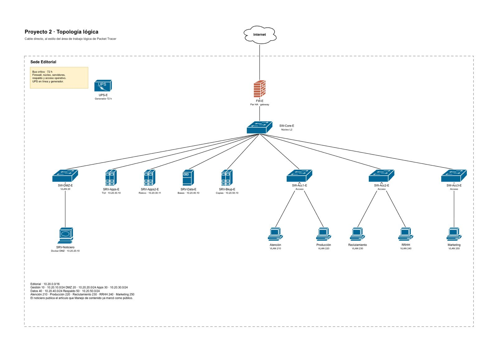
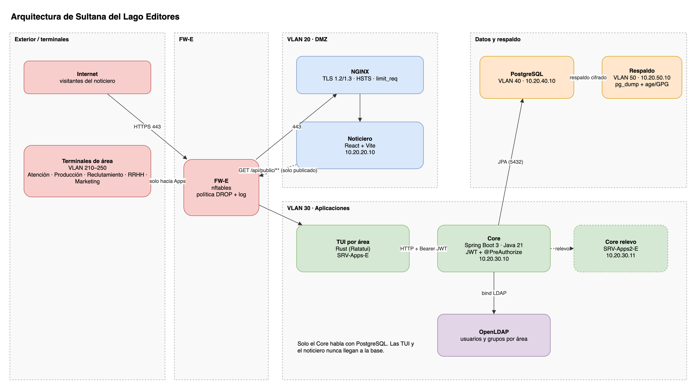
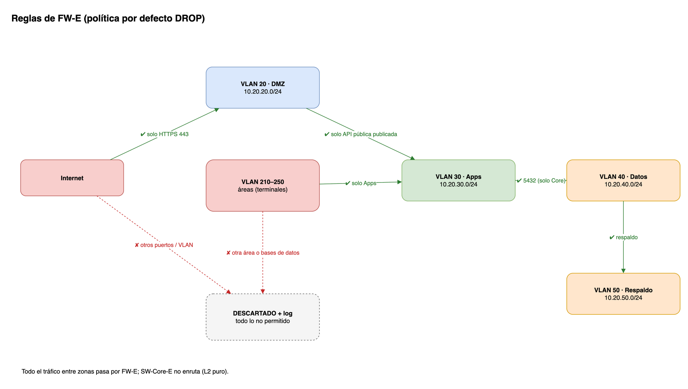
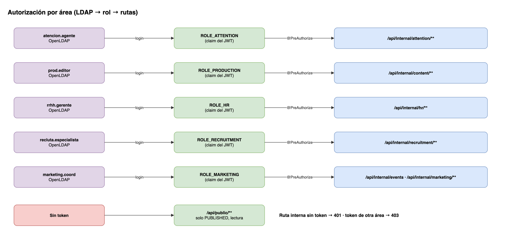
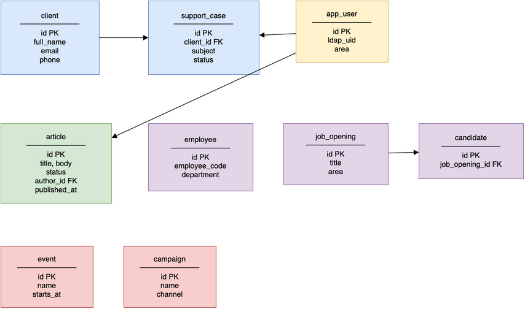
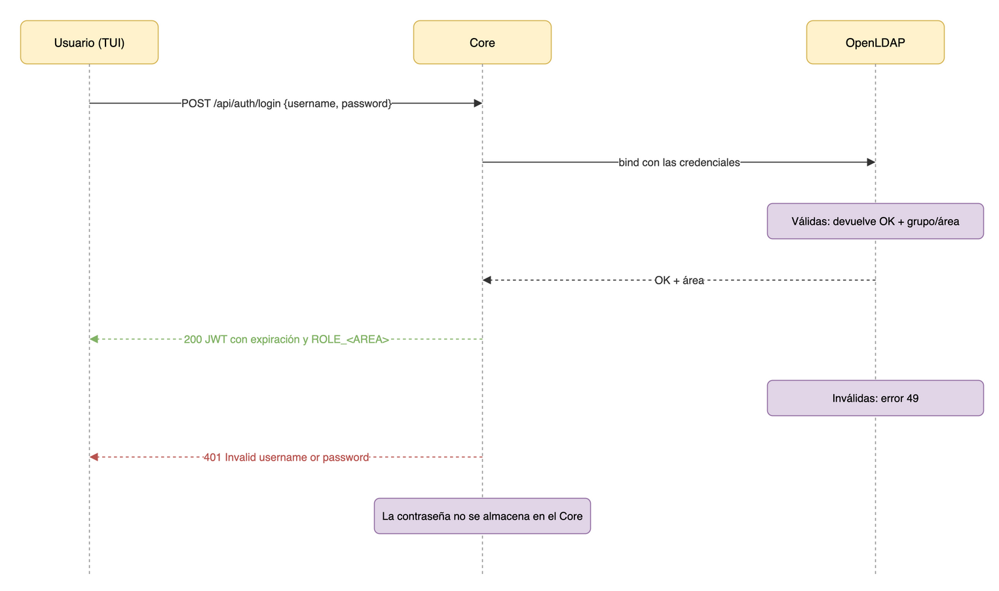
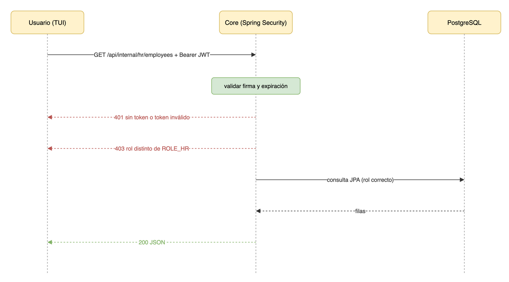
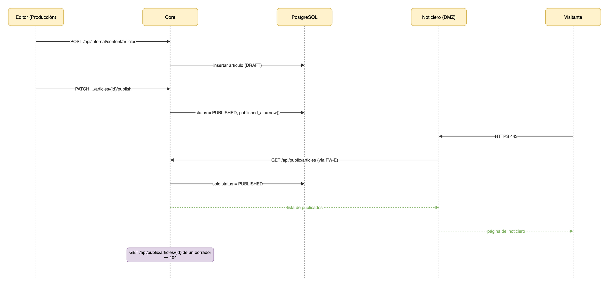

<table>
<tr>
<td width="180"></td>
<td>
<h1>Sultana del Lago Editores</h1>
<p>Sistema de información de <b>Sultana del Lago Editores</b>, una editorial multimedia, construido como monorepo para el
<b>Proyecto 2</b> de la materia de Seguridad Informática. Incluye la infraestructura de red
(simulada con Docker), las aplicaciones internas por terminal (TUI), el noticiero web público
y el informe de diseño en LaTeX.</p>
</td>
</tr>
</table>

## Topología de red

La sede de Sultana del Lago Editores usa una sola red `10.20.0.0/16`. Internet llega únicamente a **FW-E** (par HA con puerta de enlace
compartida). **SW-Core-E** es L2 puro: el firewall es la puerta de cada VLAN y decide qué red habla con cuál.

| VLAN | Función | Red | Equipos |
|---|---|---|---|
| 10 | Gestión | 10.20.10.0/24 | — |
| 20 | DMZ | 10.20.20.0/24 | SW-DMZ-E, SRV-Noticiero (10.20.20.10) |
| 30 | Aplicaciones | 10.20.30.0/24 | SRV-Apps-E (.10, TUI), SRV-Apps2-E (.11, relevo) |
| 40 | Bases de datos | 10.20.40.0/24 | SRV-Data-E (10.20.40.10) |
| 50 | Respaldo | 10.20.50.0/24 | SRV-Bkup-E (10.20.50.10) |
| 210 | Atención | — | SW-Acc1-E |
| 220 | Producción | — | SW-Acc1-E |
| 230 | Reclutamiento | — | SW-Acc2-E |
| 240 | RRHH | — | SW-Acc2-E |
| 250 | Marketing | — | SW-Acc3-E |

Reglas clave: desde internet solo entra HTTPS (443) a la DMZ; desde la DMZ solo sale la consulta
de lo ya publicado hacia la VLAN de aplicaciones; las terminales nunca llegan a las bases;
cada VLAN de área (210–250) solo alcanza la VLAN de aplicaciones a través del firewall, nunca otra área ni las bases;
el respaldo y el núcleo cuentan con energía de respaldo de 72 h (UPS en línea + generador).



## Componentes

| Componente | Tecnología | Carpeta |
|---|---|---|
| Core (API, autenticación, reglas de negocio) | Java 21, Spring Boot 3 | `services/editorial_core` |
| Apps internas (Atención, Manejo de contenido, RRHH, Manejo de eventos) | TUI | `services/editorial_tui` |
| Noticiero web público (DMZ) | Web | `services/editorial_noticiero` |
| Base de datos | PostgreSQL | `deploy/db_init` |
| Directorio / autenticación | OpenLDAP | `deploy/ldap` |
| Firewall FW-E y proxy TLS | nftables, NGINX | `deploy/firewall`, `deploy/nginx` |
| Informe de diseño | LaTeX | `docs/informe` |

## Arquitectura



Solo el Core habla con PostgreSQL; las TUI y el noticiero nunca llegan a la base.

## Reglas del firewall (FW-E)



## Autorización por área



## Base de datos



## Diagramas de secuencia

### Inicio de sesión (LDAP + JWT)



### Acceso a una ruta interna



### Publicación de un artículo y lectura en el noticiero



Los diagramas de arquitectura, firewall, autorización y secuencias son páginas del archivo editable
`docs/diagrams/diagramas-proyecto.drawio`; el modelo de base de datos está en `docs/diagrams/er-model.drawio`.

## Estructura del repositorio

```
Editorial/
├── deploy/            # Docker Compose (una red por VLAN), firewall, NGINX, LDAP, SQL
├── docs/              # Diagramas, capturas e informe LaTeX
├── scripts/           # Utilidades (arranque, secretos)
├── services/
│   ├── editorial_core/        # Backend Java
│   ├── editorial_tui/         # Aplicaciones internas por terminal
│   └── editorial_noticiero/   # Web pública
└── README.md
```

## Seguridad

La seguridad se resuelve con **librerías y herramientas probadas**, no con código propio: Spring Security
y Spring LDAP (autenticación y autorización), Bean Validation, NGINX con TLS (mkcert/certbot), nftables,
fail2ban, Trivy y OWASP Dependency-Check. El informe debe justificar cada elección.

## Coordinación (fase 1 Core)

Contrato de API, variables de entorno y notas para el equipo: [`docs/COORDINACION_EQUIPO.md`](docs/COORDINACION_EQUIPO.md).

### Alcance de la simulación Docker

`deploy/docker-compose.dev.yml` ofrece una composición local con una terminal TUI por área y una
red Docker separada para cada una. Esto reproduce aislamiento lógico para desarrollo, pero no
equivale a VLAN 802.1Q, switches, rutas inter-VLAN ni políticas reales de `FW-E`; esas propiedades
deben validarse en la infraestructura correspondiente.

Las terminales TUI no contienen datos en memoria ni perfiles de prueba. El acceso siempre se valida
contra el Core y `CORE_API_URL` debe apuntar al servicio accesible desde la red del área.

## Cómo levantar el proyecto

**Requisitos:** Docker con Docker Compose v2. Puertos libres: 8080 (Core), 3000 (noticiero) y 5432 (PostgreSQL).
No hace falta crear ningún `.env`: se usan valores de desarrollo.

### 1. Levantar todo (un solo comando)

```bash
git clone https://github.com/nullcipher-sec/Editorial.git && cd Editorial
docker compose up -d --build
```

Esto construye y arranca PostgreSQL (con esquema y datos de ejemplo), LDAP (usuarios de prueba), el Core y el
noticiero. La primera vez tarda unos minutos en construir; el Core puede tardar hasta ~1 min en responder.

| Servicio | URL |
|---|---|
| API del Core | http://localhost:8080 (documentación en `/scalar`, salud en `/actuator/health`) |
| Noticiero web | http://localhost:3000 |
| PostgreSQL | `localhost:5432` |

Comprobar que está listo: `curl http://localhost:8080/actuator/health` debe devolver `{"status":"UP"}`.

### 2. Abrir una terminal TUI (interactivas, una por área)

```bash
docker compose run --rm tui_atencion        # Atención al cliente
docker compose run --rm tui_produccion      # Producción / contenido
docker compose run --rm tui_rrhh            # Recursos Humanos
docker compose run --rm tui_reclutamiento   # Reclutamiento
docker compose run --rm tui_eventos         # Marketing / eventos
```

Inicia sesión con el usuario del área. Contraseña de todos: `EditorialDev!2026`.

| Área | Usuario |
|---|---|
| Atención | `atencion.agente` |
| Producción | `prod.editor` |
| RRHH | `rrhh.gerente` |
| Reclutamiento | `recluta.especialista` |
| Marketing / eventos | `marketing.coord` |

Teclas: `Tab` cambia de campo, `Enter` acepta, `Esc` vuelve, `Q` sale.

### Crear un usuario nuevo

```bash
./run user ana.torres "Ana Torres" MARKETING     # áreas: ATTENTION, PRODUCTION, RECRUITMENT, HR, MARKETING
./run users                                      # listar usuarios
./run user-del ana.torres                        # eliminar
```

La clave por defecto es `EditorialDev!2026` (o pásala como cuarto argumento). Solo se administra LDAP: el perfil
interno se crea solo en el primer login. Requiere el sistema levantado.

### 3. Apagar

```bash
docker compose down        # detiene y elimina contenedores y redes
docker compose down -v     # además borra los datos (reinicio limpio)
```

### Problemas frecuentes

| Síntoma | Solución |
|---|---|
| Puerto 8080, 3000 o 5432 ocupado | Detén el otro servicio o cambia `CORE_PORT`, `NOTICIERO_PORT` o `POSTGRES_PORT` |
| Login da 401 con el usuario correcto | Datos antiguos de LDAP: `docker compose down -v` y vuelve a levantar |
| El noticiero responde 502 | El Core aún arranca; espera y recarga |
| Ver logs | `docker compose logs -f editorial_core` |

Más detalle de pruebas manuales del API, 401/403 y resolución de problemas: `docs/guia-despliegue-pruebas.md`.

## Arranque rápido (desarrollo)

```bash
./run services              # PostgreSQL, LDAP y Core
./run stop                  # elimina contenedores y redes
./run tui_atencion          # abre la TUI de Atención
./run tui_produccion        # abre la TUI de Producción
./run tui_rrhh              # abre la TUI de RRHH
./run tui_recluta           # abre la TUI de Reclutamiento
./run tui_eventos           # abre la TUI de Eventos
```

El primer comando crea `deploy/.env` automáticamente desde `deploy/.env.dev.example` si todavía
no existe. Cada comando `tui_*` reutiliza los servicios ya levantados, construye solo la imagen
de la TUI pedida y la abre. La documentación del API (Scalar) está en `http://localhost:8080/scalar`. Usuarios, pruebas de 401/403 y resolución de problemas:
`docs/guia-despliegue-pruebas.md`. La topología completa con firewall, TLS y relevo se levanta con
`deploy/docker-compose.yml` (ver `deploy/`).

## Arranque rápido (desarrollo)

```bash
cd deploy
cp .env.dev.example .env          # valores de desarrollo listos para usar
docker compose -f docker-compose.dev.yml up -d --build   # postgres, ldap, core y 5 TUI
curl -s http://localhost:8080/actuator/health            # {"status":"UP"}
```

Scalar en `http://localhost:8080/scalar`. Usuarios, pruebas de 401/403 y resolución de problemas:
`docs/guia-despliegue-pruebas.md`. La topología completa con firewall, TLS y relevo se levanta con
`deploy/docker-compose.yml` (ver `deploy/`).

## Flujo de trabajo

Cada integrante trabaja en su propia rama y nadie hace push directo a `main`.
Las tareas están en los *issues* del repositorio.

| Integrante | Rama | Área |
|---|---|---|
| @marcelopcx | `dev/marcelopcx` | Backend (Core) + base de datos |
| @arrias24 | `dev/arrias24` | Aplicaciones internas TUI |
| @luiscab19 | `dev/luiscab19` | Infraestructura Docker, firewall, LDAP y seguridad lógica |
| @JhonmarMorales17 | `dev/jhonmarmorales17` | Noticiero web, datos de prueba y documentación |
