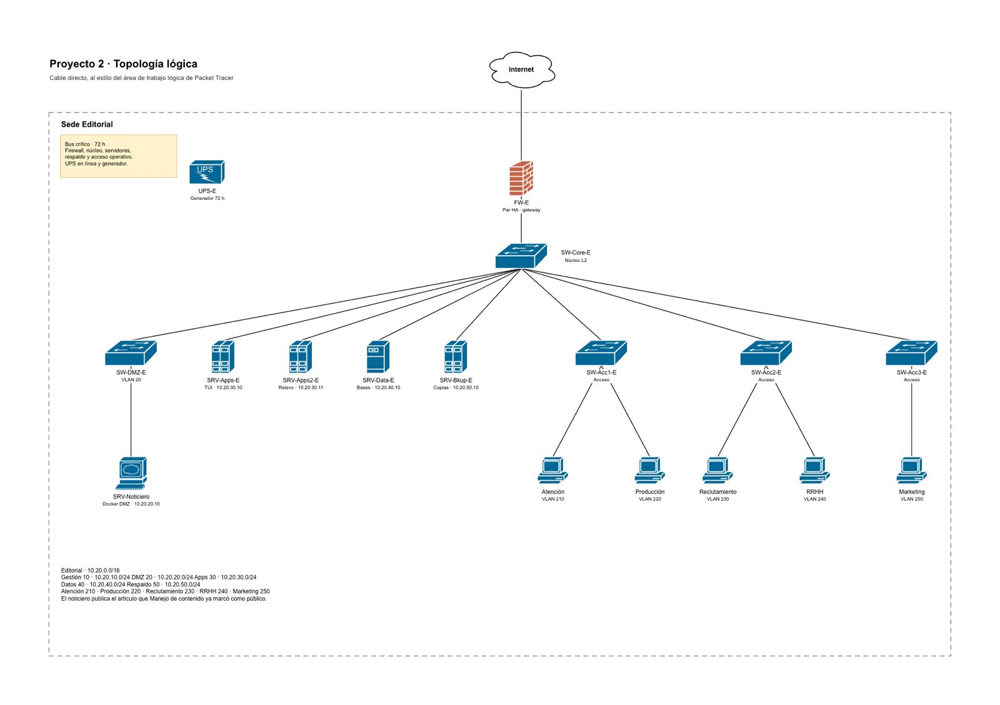

<table>
<tr>
<td width="180"></td>
<td>
<h1>Sultana del Lago Editores</h1>
<p>Sistema de información de <b>Sultana del Lago Editores</b>, una editorial multimedia, construido como monorepo para el
<b>Proyecto 2</b> de la materia de Seguridad Informática. Incluye la infraestructura de red
(simulada con Docker), las aplicaciones internas por terminal (TUI), el noticiero web público
y el informe de diseño en LaTeX.</p>
</td>
</tr>
</table>

## Topología de red

La sede de Sultana del Lago Editores usa una sola red `10.20.0.0/16`. Internet llega únicamente a **FW-E** (par HA con puerta de enlace
compartida). **SW-Core-E** es L2 puro: el firewall es la puerta de cada VLAN y decide qué red habla con cuál.

| VLAN | Función | Red | Equipos |
|---|---|---|---|
| 10 | Gestión | 10.20.10.0/24 | — |
| 20 | DMZ | 10.20.20.0/24 | SW-DMZ-E, SRV-Noticiero (10.20.20.10) |
| 30 | Aplicaciones | 10.20.30.0/24 | SRV-Apps-E (.10, TUI), SRV-Apps2-E (.11, relevo) |
| 40 | Bases de datos | 10.20.40.0/24 | SRV-Data-E (10.20.40.10) |
| 50 | Respaldo | 10.20.50.0/24 | SRV-Bkup-E (10.20.50.10) |
| 210 | Atención | — | SW-Acc1-E |
| 220 | Producción | — | SW-Acc1-E |
| 230 | Reclutamiento | — | SW-Acc2-E |
| 240 | RRHH | — | SW-Acc2-E |
| 250 | Marketing | — | SW-Acc3-E |

Reglas clave: desde internet solo entra HTTPS (443) a la DMZ; desde la DMZ solo sale la consulta
de lo ya publicado hacia la VLAN de aplicaciones; las terminales nunca llegan a las bases;
cada VLAN de área (210–250) solo alcanza la VLAN de aplicaciones a través del firewall, nunca otra área ni las bases;
el respaldo y el núcleo cuentan con energía de respaldo de 72 h (UPS en línea + generador).



## Componentes

| Componente | Tecnología | Carpeta |
|---|---|---|
| Core (API, autenticación, reglas de negocio) | Java 21, Spring Boot 3 | `services/editorial_core` |
| Apps internas (Atención, Manejo de contenido, RRHH, Manejo de eventos) | TUI | `services/editorial_tui` |
| Noticiero web público (DMZ) | Web | `services/editorial_noticiero` |
| Base de datos | PostgreSQL | `deploy/db_init` |
| Directorio / autenticación | OpenLDAP | `deploy/ldap` |
| Firewall FW-E y proxy TLS | nftables, NGINX | `deploy/firewall`, `deploy/nginx` |
| Informe de diseño | LaTeX | `docs/informe` |

## Estructura del repositorio

```
Editorial/
├── deploy/            # Docker Compose (una red por VLAN), firewall, NGINX, LDAP, SQL
├── docs/              # Diagramas, capturas e informe LaTeX
├── scripts/           # Utilidades (arranque, secretos)
├── services/
│   ├── editorial_core/        # Backend Java
│   ├── editorial_tui/         # Aplicaciones internas por terminal
│   └── editorial_noticiero/   # Web pública
└── README.md
```

## Seguridad

La seguridad se resuelve con **librerías y herramientas probadas**, no con código propio: Spring Security
y Spring LDAP (autenticación y autorización), Bean Validation, NGINX con TLS (mkcert/certbot), nftables,
fail2ban, Trivy y OWASP Dependency-Check. El informe debe justificar cada elección.

## Flujo de trabajo

Cada integrante trabaja en su propia rama y nadie hace push directo a `main`.
Las tareas están en los *issues* del repositorio.

| Integrante | Rama | Área |
|---|---|---|
| @marcelopcx | `dev/marcelopcx` | Backend (Core) + base de datos |
| @arrias24 | `dev/arrias24` | Aplicaciones internas TUI |
| @luiscab19 | `dev/luiscab19` | Infraestructura Docker, firewall, LDAP y seguridad lógica |
| @JhonmarMorales17 | `dev/jhonmarmorales17` | Noticiero web, datos de prueba y documentación |
